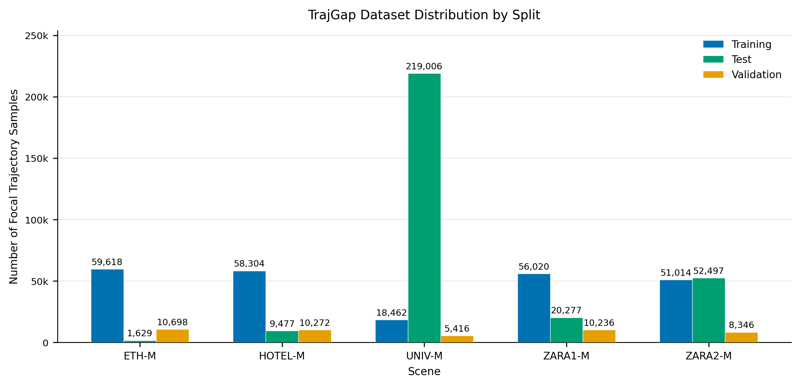

# TrajGap-Bench 数据集分布

> 统计口径：每个场景和 split 将官方 Easy、Hard 数据合并为 Mixed；样本数按 `TrajGapDataset` 实际产生的 focal 行人轨迹计数。

[PDF 矢量图](../figures/results/trajgap_dataset_distribution.pdf)

| 场景 | Training | Test | Validation | 合计 |
|---|---:|---:|---:|---:|
| ETH-M | 59,618 | 1,629 | 10,698 | 71,945 |
| HOTEL-M | 58,304 | 9,477 | 10,272 | 78,053 |
| UNIV-M | 18,462 | 219,006 | 5,416 | 242,884 |
| ZARA1-M | 56,020 | 20,277 | 10,236 | 86,533 |
| ZARA2-M | 51,014 | 52,497 | 8,346 | 111,857 |
| **Total** | **243,418** | **302,886** | **44,968** | **591,272** |

Train、validation、test 均使用同一 Mixed 合并规则；每个样本以一个 focal 行人为中心，包含 8 帧历史输入和 12 帧未来目标。
